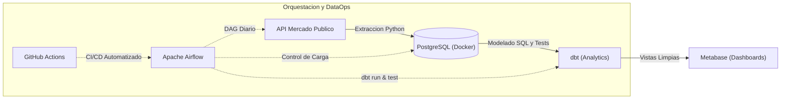

# Observatorio de Compras Publicas - Chile


Plataforma integral de Ingenieria de Datos (End-to-End) disenada para extraer, almacenar, transformar, orquestar y visualizar compras publicas del Estado de Chile utilizando la API oficial de Mercado Publico.

El proyecto implementa las mejores practicas del **Modern Data Stack**, incluyendo contenerizacion con Docker, modelado analitico con dbt, orquestacion mediante DAGs en Apache Airflow y pruebas continuas con GitHub Actions.

---

## Arquitectura del Pipeline



---

## Stack Tecnologico (Modern Data Stack)

| Capa | Tecnologia | Descripcion / Proposito |
| :--- | :--- | :--- |
| **Ingesta** | Python 3 (Requests, Pandas) | Extraccion desde API REST y persistencia en capa cruda (JSON). |
| **Almacenamiento** | PostgreSQL 15 | Base de datos relacional contenerizada en Docker. |
| **Transformacion** | dbt (Data Build Tool) | Modelado de datos, desnormalizacion y pruebas de calidad (tests). |
| **Orquestacion** | Apache Airflow 2.8 | Programacion y monitoreo de DAGs en contenedores dedicados. |
| **Visualizacion (BI)** | Metabase | Paneles interactivos de negocio conectados a las vistas de dbt. |
| **CI/CD & DataOps** | GitHub Actions | Pruebas continuas de sintaxis (Flake8), DagBag y dbt parse. |
| **Exploracion** | DBeaver | Cliente de administracion y exploracion SQL relacional. |

---

## Hoja de Ruta (Roadmap del Proyecto)

- [x] **Hito 0:** Configuracion del entorno virtual (`venv`) y control de versiones con Git.
- [x] **Hito 1:** Script basico de Python y diccionario de datos preliminar.
- [x] **Hito 2:** Conexion a la API oficial de Mercado Publico y almacenamiento inmutable en capa cruda.
- [x] **Hito 3:** Infraestructura contenerizada en Docker (PostgreSQL) y carga masiva idempotente.
- [x] **Hito 4:** Analitica exploratoria con SQL y traduccion condicional de estados (`CASE WHEN`).
- [x] **Hito 5:** Business Intelligence interactivo en Metabase con lectura directa de PostgreSQL.
- [x] **Hito 6:** Transformacion profesional con dbt, estandarizacion snake_case y pruebas de asercion (`PASS=4`).
- [x] **Hito 7:** Orquestacion completa del pipeline mediante un DAG automatizado en Apache Airflow.
- [x] **Hito 8:** Integracion continua (CI/CD) con GitHub Actions para validacion automatica en la nube.

---

## Como ejecutar el proyecto localmente (Quickstart)

### Requisitos previos
* Docker y Docker Desktop instalados y en ejecucion.
* Python 3.9+ instalado.
* Git.

### 1. Clonar el repositorio
```bash
git clone https://github.com/DanielMelejPinto/observatorio-compras-publicas-chile.git
cd observatorio-compras-publicas-chile
```

### 2. Configurar variables de entorno
Crea un archivo `.env` en la raiz con tu ticket de la API:
```env
TICKET_MERCADO_PUBLICO=tu_ticket_aqui
```

### 3. Levantar la plataforma completa en Docker
```bash
docker compose up -d
```

Este comando iniciara en paralelo:
* **PostgreSQL:** `localhost:5432` (Base de datos transaccional y analitica)
* **Metabase:** `http://localhost:3000` (Dashboards interactivos de BI)
* **Apache Airflow:** `http://localhost:8080` (Orquestador de pipelines - Usuario: `admin`)

---

## Documentacion y Bitacora Tecnica
Para consultar el registro detallado de cada hito, decisiones de arquitectura, comandos de terminal ejecutados y desafios resueltos paso a paso, revisa:
* [`docs/avance.md`](docs/avance.md)